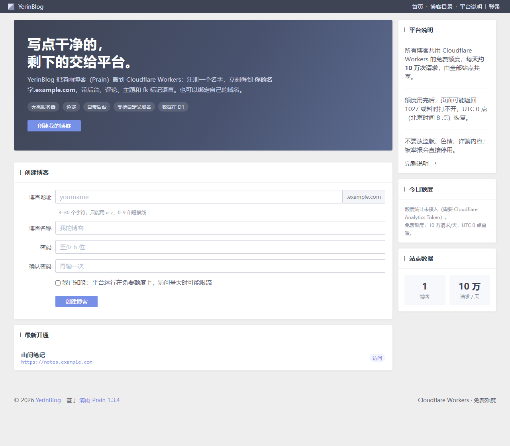
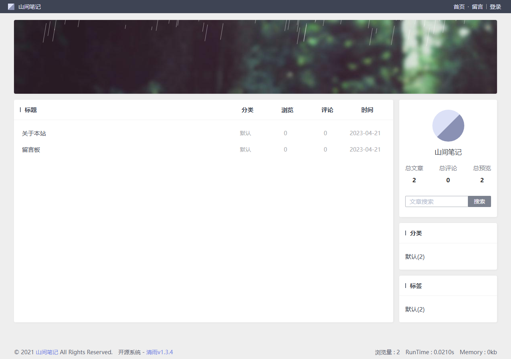

# YerinBlog

> 把 [Prain 清雨博客](https://prain.cn) 1.3.4 完整搬到 Cloudflare Workers，并做成多租户博客分发平台：
> 注册一个子域，就得到一套带后台、评论、主题、fk 标记语言的博客，零服务器、零数据库运维。
>
> 只想要单个博客？用单站版：[Prain-for-CloudflareWorker](https://github.com/FengHuaworker/Prain-for-CloudflareWorker)

- **平台**：`example.com`（根域）→ 注册 / 登录 / 控制台 / 目录 / 运维
- **博客**：`<name>.example.com` → 独立的 Prain 实例（前台 + 后台）
- **数据**：D1（SQLite）+ KV；不依赖 R2
- **成本**：Cloudflare Workers 免费计划即可跑（10 万请求/天，账号级共享）




## 功能

### 平台

| 模块 | 说明 |
| --- | --- |
| 注册 | 3–30 字符，仅 `a-z 0-9 -`；同 IP 每日限额（默认 5） |
| 保留名 | `admin` / `my` / `dashboard` / `api` / `login` / `billing` 等 225 个精确名 + 27 个前缀，访问时 302 回根域 |
| 控制台 | 站点信息、密码、统计、登记自定义域名、删除博客 |
| 单点登录 | 控制台签发 5 分钟 HMAC 票据，直接进 `<name>.域名/?admin/login&ticket=…` |
| 运维面板 | `/ops`：概览、博客管理（搜索/筛选/分页/批量停用删除）、单站详情、内容审核、域名、平台设置 |
| 额度显示 | 首页与 `/ops` 显示今日 Worker 请求已用/剩余（需只读 Analytics Token） |
| 自定义域名 | 控制台登记 → `domain` 表 → 按 Host 解析；证书需 Cloudflare for SaaS |

### 博客（Prain 1.3.4）

| 模块 | 原版 | 本移植 |
| --- | --- | --- |
| 首页 / 分类 / 标签 / 搜索 / 文章页 | ✅ | ✅ 路由与分页参数一致 |
| 评论（楼中楼、验证码、敏感词、灌水限制） | ✅ | ✅ |
| 登录 / Token 校验 / 失败锁定 | ✅ | ✅ 签名 Cookie |
| 后台：导航 / 分类 / 友链 / 文章 CRUD / 批量移动删除 | ✅ | ✅ |
| 网站设置、主题、扩展、错误日志 | ✅ | ✅ |
| `.sx` 应用包导入导出 | ✅ | ✅ 常见 PHP 模板自动转换 |
| fk 标记语言 | ✅ | ✅ 逐条移植 |
| 模板语法 `{$}` `{#}` `{{}}` `{if}` `{foreach}` `{include}` `{url}` hook | ✅ | ✅ 解释执行，不用 eval |
| 上传 | ✅ GD | ✅ KV；不生成缩略图 |
| 在线系统同步 | ✅ | ⚠️ 改为重新部署 |

## 架构

```
请求 ──► Worker
          ├─ Host = 根域            → 控制面（注册 / 控制台 / 运维）
          ├─ Host = <name>.根域     → 租户 Prain（site = name）
          ├─ Host = 保留名          → 302 回根域
          └─ Host = 自定义域名      → domain 表 → 租户

D1：site / conf / article / comment / pkg / file / ini / captcha / visit / domain / platform_conf
KV：site:<name>:tpl:* / ext:* / upload:*（每站独立前缀）
```

- 所有业务表以 `site` 列隔离，复合主键 `(site, id)`。
- 静态资源走 Workers Assets（`run_worker_first = false`），不计 Worker 请求。
- 模板 AST 按 `site + 主题版本` 缓存，避免重复解析。

## 快速开始

```bash
git clone <your-repo> yerinblog && cd yerinblog
npm install

npx wrangler login
npx wrangler d1 create yerinblog
npx wrangler kv namespace create PRAIN_KV
```

把两个 ID 填进 `wrangler.toml`，并把 `BASE_DOMAIN` 改成你的域名：

```toml
[[d1_databases]]
binding = "DB"
database_name = "yerinblog"
database_id = "REPLACE_WITH_YOUR_D1_DATABASE_ID"

[[kv_namespaces]]
binding = "KV"
id = "REPLACE_WITH_YOUR_KV_NAMESPACE_ID"

[vars]
BASE_DOMAIN = "example.com"
PLATFORM_NAME = "YerinBlog"

routes = [
  { pattern = "example.com/*", zone_name = "example.com" },
  { pattern = "*.example.com/*", zone_name = "example.com" }
]
```

```bash
npx wrangler secret put SESSION_SECRET      # 32 位以上随机串
npx wrangler secret put OPS_PASSWORD        # /ops 运维密码
npm run deploy
```

首次请求会自动建表（`schema.sql` 随 Worker 打包），无需手动执行 SQL。

### DNS

在域名所在账号加两条记录，**都开代理**：

| 类型 | 名称 | 内容 | 代理 |
| --- | --- | --- | --- |
| A | `@` | `192.0.2.1` | 开 |
| A | `*` | `192.0.2.1` | 开 |

`*` 只覆盖一层：`a.b.example.com` 不需要也不匹配。保留名不需要单独建 DNS。

## 本地开发

```bash
npm run dev        # http://127.0.0.1:8787（平台）
```

模拟子域（Host 分流）：

```bash
curl --noproxy '*' --resolve demo.example.com:8787:127.0.0.1 \
     http://demo.example.com:8787/
```

Chrome 可用 `--host-resolver-rules="MAP demo.example.com 127.0.0.1"`。

两套测试数据互不干扰：`wrangler dev --persist-to .wrangler/a`、`.wrangler/b`。

## 运维面板 `/ops`

密码来自 `OPS_PASSWORD` secret；令牌里带密码指纹，改密码后旧会话立即失效。

| 页面 | 能做什么 |
| --- | --- |
| 概览 | 博客/正常/停用/文章/评论/浏览，今日新增、24h 错误、上传文件与占用，近 7 天注册、访问量 Top、最新评论 |
| 博客 | 搜索、状态筛选、排序、分页、批量启用/停用/删除 |
| 单站详情 | 改资料、重置后台密码、停用/删除、进后台、删文章与评论 |
| 内容 | 全站评论/文章搜索与删除 |
| 域名 | 自定义域名映射、解除绑定 |
| 设置 | 注册开关、同 IP 限额、首页公告 |

## 额度显示（可选）

```bash
npx wrangler secret put CF_ANALYTICS_TOKEN
```

Token 需要 **Account → Account Analytics → Read**（只读）。再把 `CF_ACCOUNT_ID` 填进 `wrangler.toml`。

- 数据来自 Cloudflare GraphQL Analytics，Worker 内缓存 10 分钟，延迟约 1–2 分钟。
- 未配置时卡片显示「额度统计未接入」，不影响其它功能。
- 也可直接 `GET /api/quota`。

## 额度用完会怎样

- 免费计划 10 万请求/天，**UTC 0 点（北京时间 8 点）重置**；超出后动态请求返回 **1027**。
- 静态资源由 Assets 返回，不计 Worker 请求；但页面是动态渲染的，所以首页、文章、后台、评论都会打不开。
- 想「额度用完还能看」：升级 Workers Paid（$5/月，1000 万请求），或把前台预渲染成静态资源（评论与后台仍不可用）。

## 安全

- 密码哈希沿用 Prain 的 md5（兼容旧数据）；新站建议改为更强算法。
- 评论输出做了 HTML 转义（原版直接输出，有存储型 XSS）。
- 上传目录独立 KV 前缀，SVG 直接访问时加 `CSP: default-src 'none'`。
- 不要把 `wrangler.prod.toml`、`.dev.vars`、`node_modules`、`.wrangler` 提交到仓库。
- 生产环境务必设置 `SESSION_SECRET` 与强 `OPS_PASSWORD`。

## 与 PHP 版的差异

1. 不执行 PHP：主题/扩展里的 PHP 逻辑不能跑，导入 `.sx` 时会尽力转成模板语法，其余标记 `<!-- unp: -->`。
2. 没有 GD：不生成缩略图，`img` 存原图。
3. 在线系统同步改为重新部署。
4. 官网应用中心（账号/支付）改为本地导入导出 + 跳转官网。
5. 评论输出转义、上传落 KV，属于平台适配。

## 目录

```
src/
├─ app.ts                  Host 分流 / 请求上下文 / 静态资源 / 错误日志
├─ routes/
│  ├─ platform.ts          平台：注册 / 登录 / 控制台 / 目录 / API
│  ├─ ops.ts               运维：概览 / 博客 / 内容 / 域名 / 设置
│  ├─ front.ts             前台：index/category/tag/search/page/comment/upload/vcode
│  └─ admin.ts             后台：登录/文章/设置/主题/扩展/错误日志
├─ lib/
│  ├─ db.ts                D1 数据层（按 site 隔离）
│  ├─ platform.ts          站点 CRUD / 会话 / 票据
│  ├─ ops.ts               运维查询与统计
│  ├─ quota.ts             Worker 额度（GraphQL）
│  ├─ subdomain.ts         子域校验 + 保留名 + Host 分类
│  ├─ session.ts           签名 Cookie / HMAC 令牌
│  ├─ tpl.ts expr.ts fk.ts 模板引擎 / 表达式 / fk 标记语言
│  ├─ pkg.ts sx.ts         主题扩展包
│  └─ upload.ts captcha.ts store.ts hooks.ts
└─ views/                  平台 / 运维 / 主题 / 后台模板
```

## 许可

MIT。上游 [prain.cn](https://prain.cn) 的版权声明保留在 [LICENSE](LICENSE) 中；本项目是在其 1.3.4 源码基础上做的 Workers 移植与多租户改造。

主题、扩展、`public/` 下的静态资源版权归原作者所有。

## 维护者备注

本仓库的 `wrangler.toml` 是脱敏模板（占位 ID、`example.com`）。实际部署配置放在 `wrangler.prod.toml`（已 gitignore），命令：

```bash
npm run deploy:prod
```

直接 `npm run deploy` 会按模板部署，可能覆盖线上域名与绑定，别用错。
